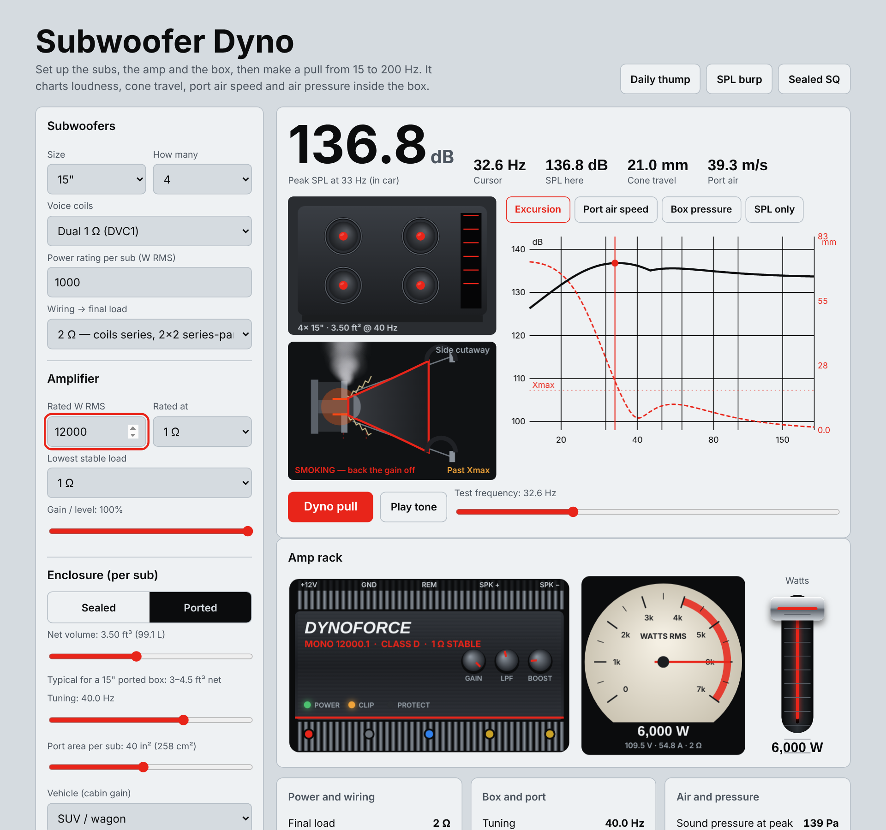

# Subwoofer Dyno

### ▶ [Use it on the web](https://hardwaremack-prog.github.io/Subwoofer-Dyno/)

A browser dyno for car-audio subwoofers. Pick the sub size, voice coils, wiring, amp and box, then make a pull from 15 to 200 Hz.

- SPL curve with cabin gain, cone excursion vs Xmax, port air speed, and air pressure inside the box
- Front view of the subs in the box plus a side cutaway: the cone moves, the voice coil glows, and it smokes when overpowered
- Amp rack: faceplate with POWER / CLIP / PROTECT lights, analog wattage gauge, and a wattage lever
- Wiring finder (final ohm load), port length, -3 dB point, fuse, wire gauge and alternator advice
- Tech inspection warnings for overpowering, bottoming out, port chuffing and unstable amp loads

Use it on the web at **https://hardwaremack-prog.github.io/Subwoofer-Dyno/**, or download `index.html` and open it in any browser. No install, no internet needed.

Driver numbers are typical for each sub size, not a specific brand. The physics is the standard sealed/vented Thiele–Small model, good for comparing setups.
